# Simple CRUD API on AWS ECS Fargate (Terraform)


Deploys the Django REST API from this repository to **Amazon ECS Fargate** behind an **Application Load Balancer**, entirely with Terraform. The image is built from the repo's own Dockerfile and stored in **ECR**, and the Django secret key is generated by Terraform and injected at runtime from **AWS Secrets Manager**. Logs go to **CloudWatch**.

I deployed it, tested it through the load balancer, stopped the running task to watch ECS recover, rolled out a second image version, and then removed everything with `terraform destroy`. Every step below has a screenshot from that run. Grey boxes hide my AWS account ID, account name and public IP addresses.

## Contents

1. [Architecture](#architecture)
2. [What Terraform creates](#what-terraform-creates)
3. [Step 1: Build and test the Docker image locally](#step-1-build-and-test-the-docker-image-locally)
4. [Step 2: Initialise and validate Terraform](#step-2-initialise-and-validate-terraform)
5. [Step 3: Create the ECR repository](#step-3-create-the-ecr-repository)
6. [Step 4: Build and push the image](#step-4-build-and-push-the-image)
7. [Step 5: Check the image and its scan in ECR](#step-5-check-the-image-and-its-scan-in-ecr)
8. [Step 6: Plan and apply the full stack](#step-6-plan-and-apply-the-full-stack)
9. [Step 7: Check the resources in the AWS console](#step-7-check-the-resources-in-the-aws-console)
10. [Step 8: Test the API through the load balancer](#step-8-test-the-api-through-the-load-balancer)
11. [Step 9: Check health from the command line](#step-9-check-health-from-the-command-line)
12. [Step 10: Stop the task and watch ECS recover](#step-10-stop-the-task-and-watch-ecs-recover)
13. [Step 11: Roll out a new version](#step-11-roll-out-a-new-version)
14. [Step 12: Destroy everything](#step-12-destroy-everything)
15. [Results summary](#results-summary)
16. [Problems I hit and how I fixed them](#problems-i-hit-and-how-i-fixed-them)
17. [Known limits](#known-limits)

## Architecture

```
Internet ──(HTTP :80, my IP only)──> Application Load Balancer (2 public subnets, 2 AZs)
                                              │  (port 8000, from the ALB security group only)
                                              ▼
                              ECS Fargate service ── task ── Django + gunicorn container
                                   │            │
                         image from ECR     secret key from Secrets Manager
                                              logs to CloudWatch
```

Tasks run in public subnets with public IPs, so no NAT gateway is needed. The task security group still blocks everything except the load balancer.

## What Terraform creates

| File | Resources |
|---|---|
| `network.tf` | VPC (`10.20.0.0/16`), internet gateway, 2 public subnets in 2 AZs, route table, lookup of my public IP |
| `security.tf` | Load balancer security group (port 80 from my IP only), task security group (port 8000 from the load balancer only) |
| `ecr.tf` | ECR repository (immutable tags, scan on push, keeps the last 5 images) |
| `secrets.tf` | A random 64-character Django secret key stored in Secrets Manager |
| `iam.tf` | Execution role (pulls the image, writes logs, reads the secret) and an empty task role |
| `logs.tf` | CloudWatch log group, 7-day retention |
| `alb.tf` | Load balancer, target group checking `/api/v1/locations/`, HTTP listener |
| `ecs.tf` | Cluster, Fargate task definition, service with a deployment circuit breaker |

The full `terraform apply` created **28 resources**, plus the ECR repository created beforehand, so `terraform destroy` removed **29**.

## Step 1: Build and test the Docker image locally

The `Dockerfile` and `.dockerignore` sit in the repo root, next to `manage.py` and `requirements.txt`. The image uses `python:3.12-slim`, installs the requirements, runs as a non-root user, and starts gunicorn after running the migrations.

```bash
docker build -t simple-crud-api .
docker run --rm -p 8000:8000 \
  -e DJANGO_SECRET_KEY='any-long-random-value-for-testing' \
  -e DJANGO_DEBUG=0 \
  -e DJANGO_ALLOWED_HOSTS='*' \
  simple-crud-api
```

Build:

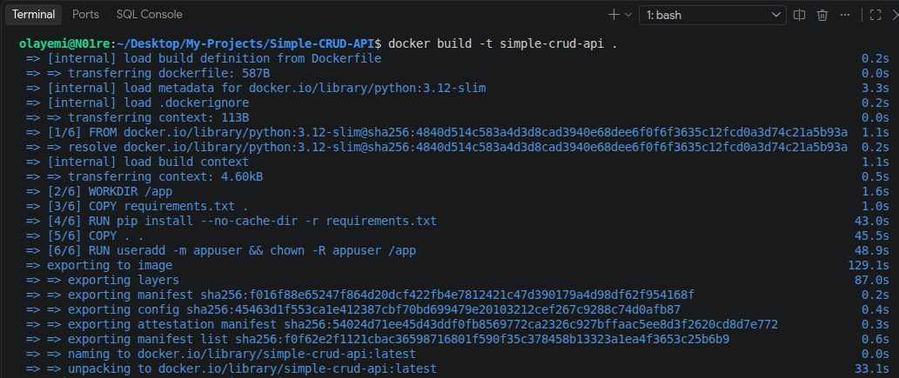

Run: the migrations apply and gunicorn 23.0.0 starts with two workers.

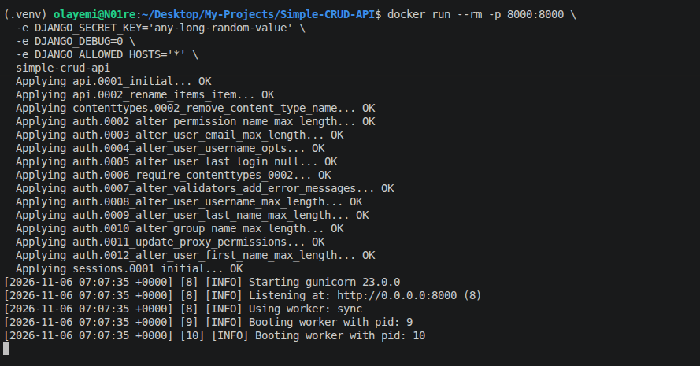

In a second terminal, the API answers with an empty list, and `docker ps` shows the container up.

```bash
curl http://localhost:8000/api/v1/locations/
```

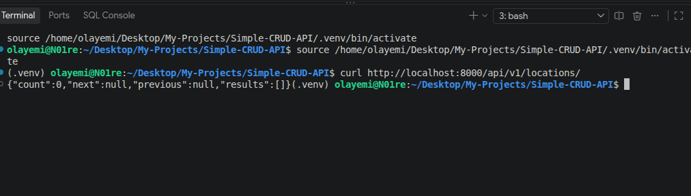

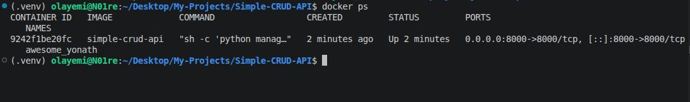

## Step 2: Initialise and validate Terraform

From the `terraform` folder. Check the backend block in `providers.tf` first (bucket, region, profile), and copy `terraform.tfvars.example` to `terraform.tfvars`.

```bash
cd terraform
terraform init
terraform validate
```

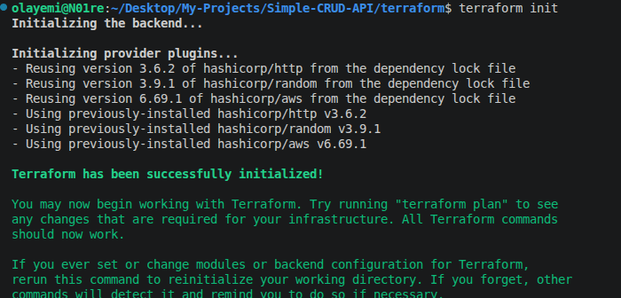

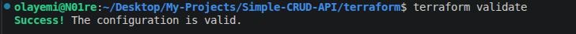

## Step 3: Create the ECR repository

The service needs an image that already exists, so the repository is created first with a targeted apply.

```bash
terraform apply -target=aws_ecr_repository.app
```

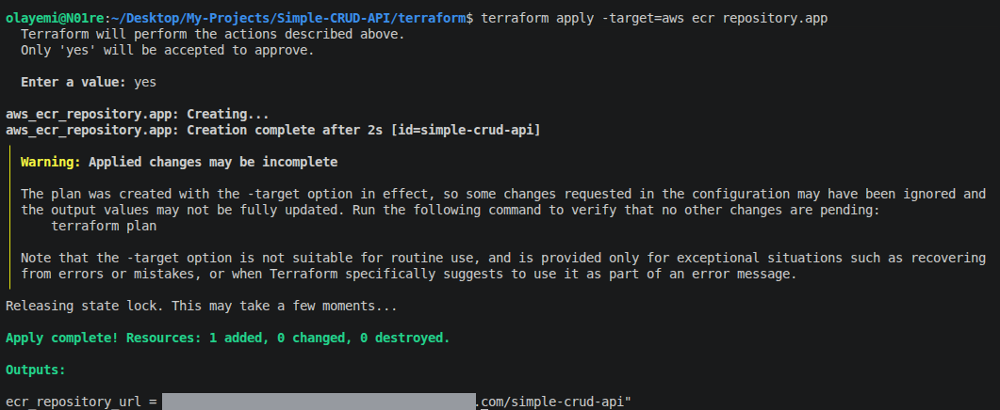

## Step 4: Build and push the image

Run this from the **repo root**. `--platform linux/amd64` matters on Apple Silicon, because the task definition runs on X86_64. I used a clean `DOCKER_CONFIG` folder for the login to avoid a broken credential helper.

```bash
export DOCKER_CONFIG=$HOME/.docker-ecr
mkdir -p $DOCKER_CONFIG
REPO=$(terraform -chdir=terraform output -raw ecr_repository_url)

aws ecr get-login-password --region eu-west-2 --profile vscode \
  | docker login --username AWS --password-stdin "${REPO%%/*}"

docker build --platform linux/amd64 --provenance=false -t "$REPO:v1" .
docker push "$REPO:v1"
```

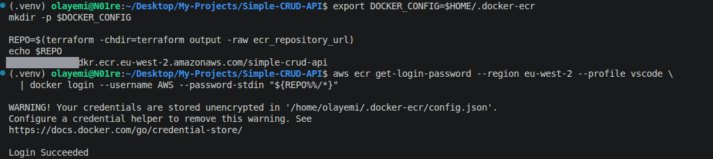

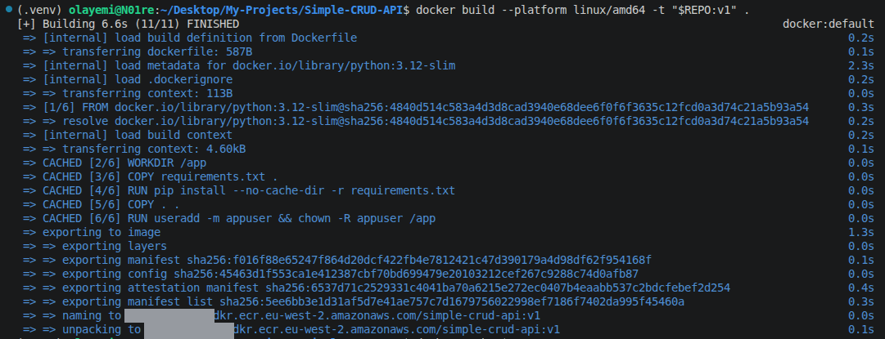

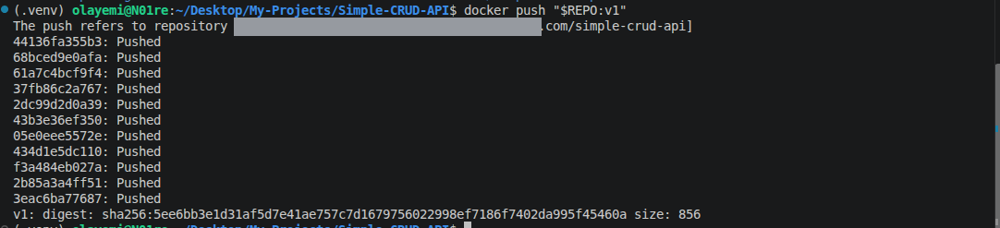

> In my run I built without `--provenance=false`, so Docker also pushed an attestation manifest and ECR lists three entries for `v1` (an image index, an "Other" attestation and the image itself). Adding the flag pushes one plain image, which ECR can scan directly.

## Step 5: Check the image and its scan in ECR

The repository holds the `v1` image. ECR scans on push, and the scan result sits on the image itself (the row marked "Image"): 0 critical, 4 high, 9 medium and 3 low findings. I did not patch the base image.

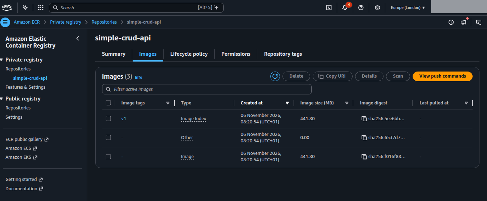

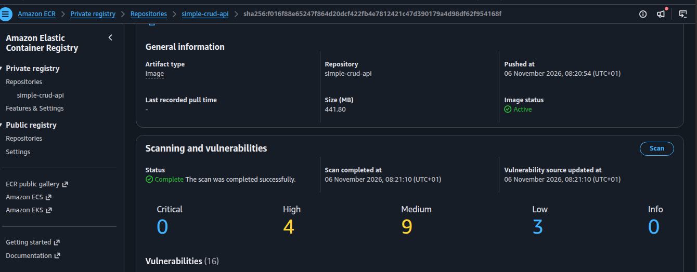

## Step 6: Plan and apply the full stack

```bash
cd terraform
terraform plan
terraform apply
```

The plan adds 28 resources.

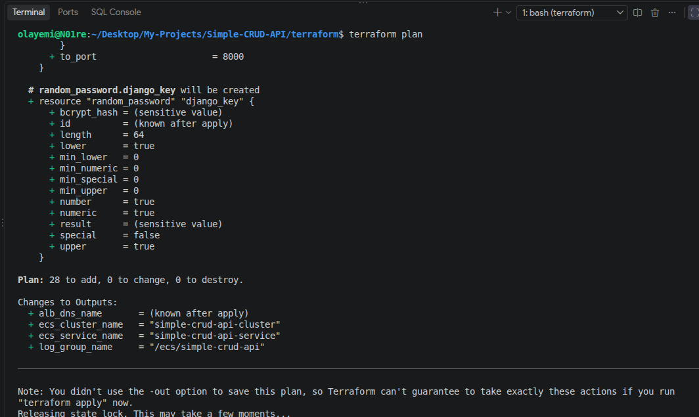

The apply finishes with the load balancer address, the ECR URL, and the cluster, service and log group names as outputs.

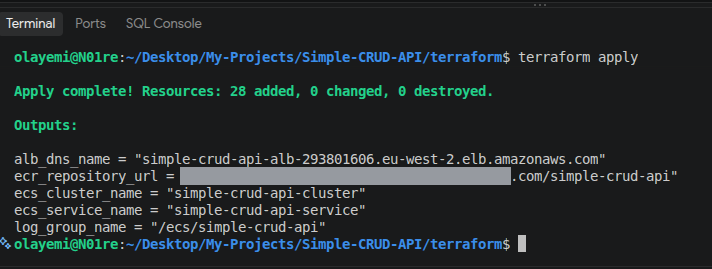

## Step 7: Check the resources in the AWS console

Wait one to two minutes for the target to become healthy.

**ECS cluster and service.** One service, one running task.

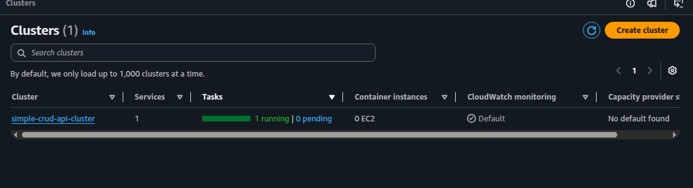

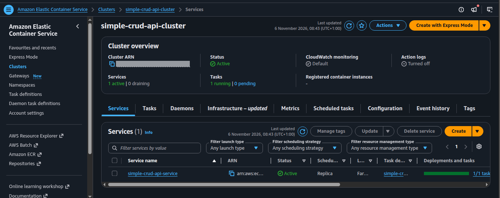

**Deployment.** The first deployment completed with the circuit breaker reporting 0 of 3 failed tasks, and the service reached a steady state.

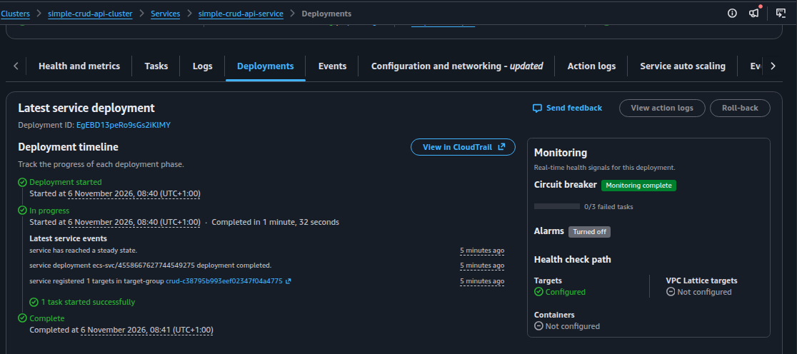

**Secret injected from Secrets Manager.** The task definition reads `DJANGO_SECRET_KEY` with `valueFrom`, so the value is not in the code or the task definition. `DJANGO_DEBUG` is `0`, and `DJANGO_ALLOWED_HOSTS` is `*` because the load balancer health check sends the task's private IP as the Host header.

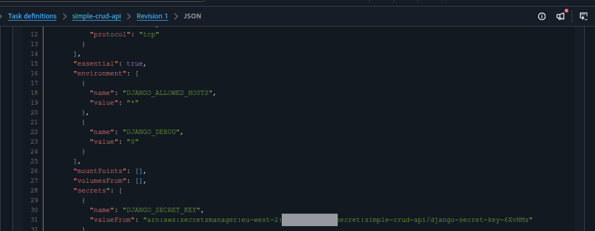

**Target group.** The single target is healthy on port 8000.

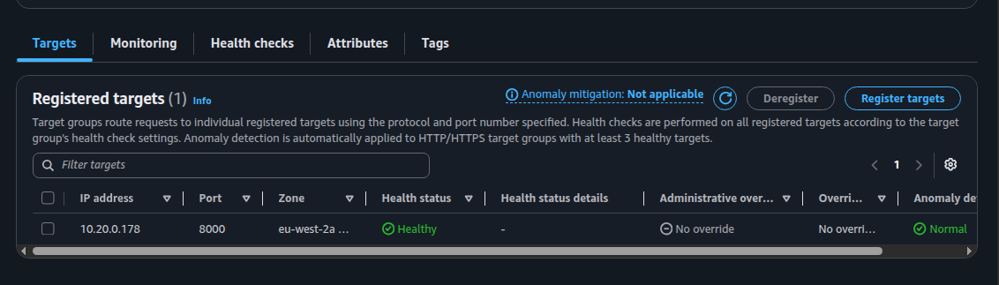

**Load balancer.** Internet-facing, in two availability zones, with an HTTP:80 listener forwarding to the target group.

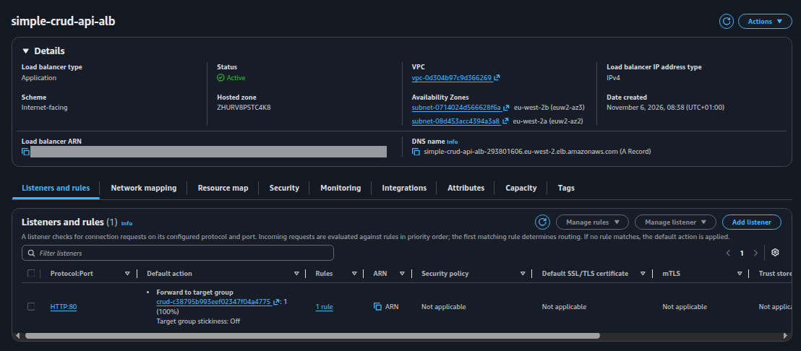

**CloudWatch logs.** The task's log stream shows the migrations and gunicorn starting.

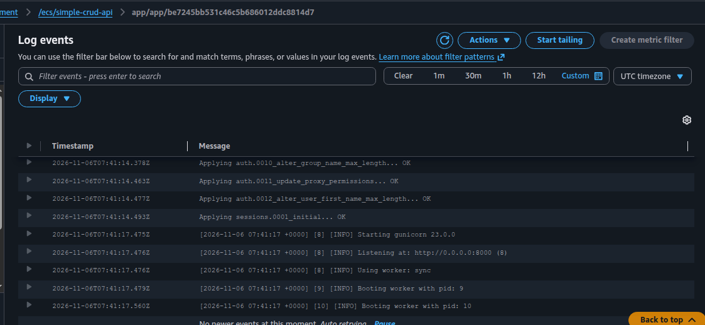

**Security groups.** The load balancer accepts HTTP on port 80 (the source is limited to my IP). The task accepts port 8000 only from the load balancer's security group.

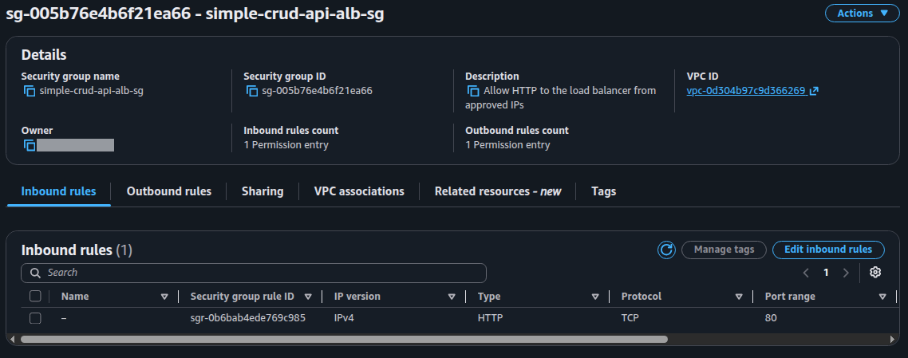

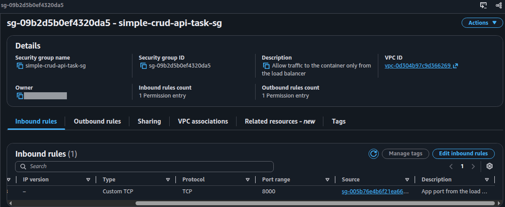

**Network.** A VPC with two public subnets in different availability zones, one route table and an internet gateway.

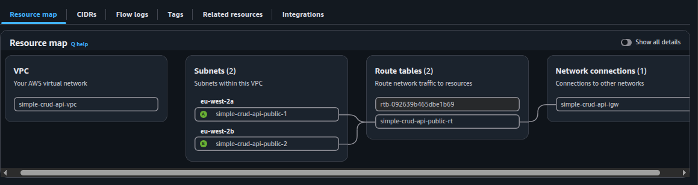

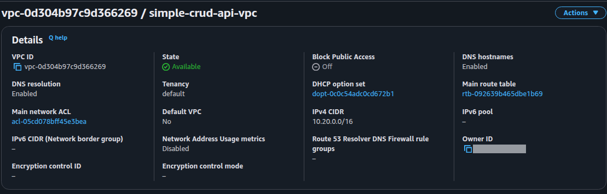

## Step 8: Test the API through the load balancer

```bash
cd terraform
ALB=$(terraform output -raw alb_dns_name)
echo $ALB
```

Empty list on a fresh deployment:

```bash
curl -s http://$ALB/api/v1/locations/ | python3 -m json.tool
```

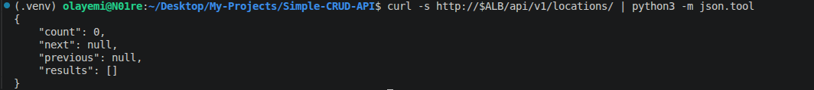

Create an item:

```bash
curl -s -X POST http://$ALB/api/v1/items/ -H 'Content-Type: application/json' \
  -d '{"itemName":"Laptop","itemLocation":1}'
```

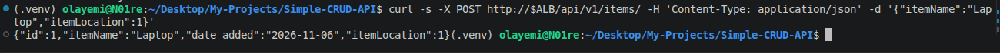

List items, then filter them by location:

```bash
curl -s http://$ALB/api/v1/items/ | python3 -m json.tool
curl -s "http://$ALB/api/v1/items/?location=1" | python3 -m json.tool
```

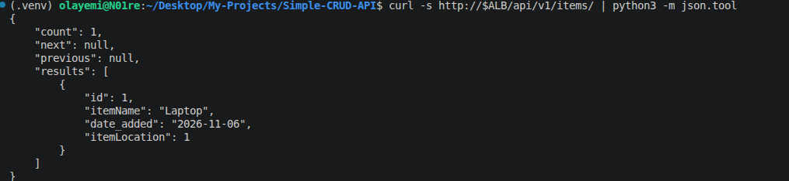

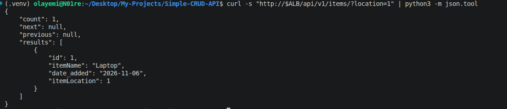

Partial update of a location with `PATCH`:

```bash
curl -s -X PATCH http://$ALB/api/v1/locations/1/ -H 'Content-Type: application/json' \
  -d '{"locationName":"Warehouse B"}'
```

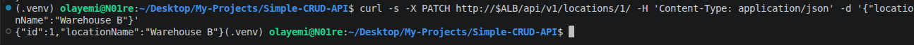

Validation: a duplicate location name is rejected.

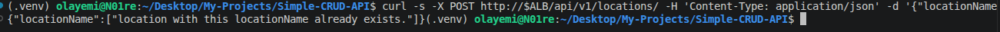

Pagination: after creating 25 more items, the list reports a count of 26 and a `next` link to page 2.

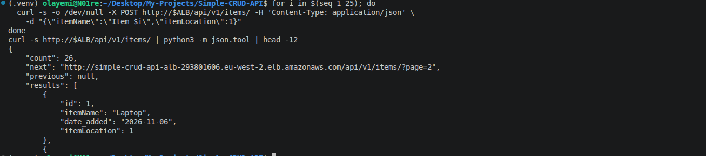

Delete returns `204`:

```bash
curl -s -o /dev/null -w "%{http_code}\n" -X DELETE http://$ALB/api/v1/items/1/
```

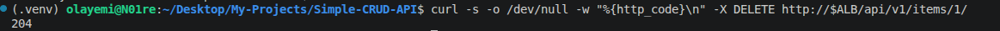

An unknown path returns the plain Django 404 (debug is off, so no stack trace is shown):

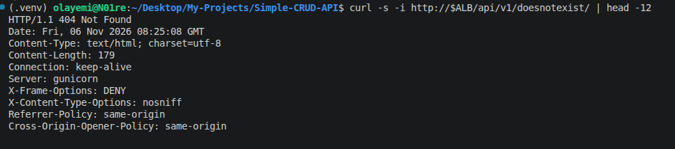

**Direct access to the task is blocked.** A request straight to the task's public IP on port 8000 times out, so the load balancer is the only way in.

```bash
curl -m 5 http://<task-public-ip>:8000/api/v1/locations/
```

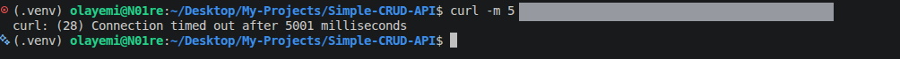

## Step 9: Check health from the command line

Service status:

```bash
aws ecs describe-services --cluster $CLUSTER --services $SERVICE $AWS \
  --query 'services[0].{status:status,running:runningCount,desired:desiredCount}'
```

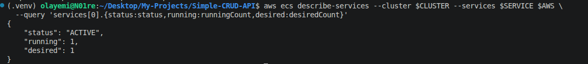

Target health:

```bash
TG=$(aws elbv2 describe-target-groups $AWS \
  --query "TargetGroups[?starts_with(TargetGroupName,'crud-')].TargetGroupArn" --output text)
aws elbv2 describe-target-health --target-group-arn $TG $AWS --query 'TargetHealthDescriptions[].TargetHealth.State'
```

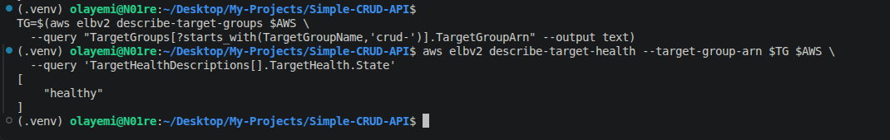

The secret exists in Secrets Manager (only its name and creation date are queried, never the value):

```bash
aws secretsmanager describe-secret --secret-id simple-crud-api/django-secret-key $AWS \
  --query '{Name:Name,Created:CreatedDate}'
```

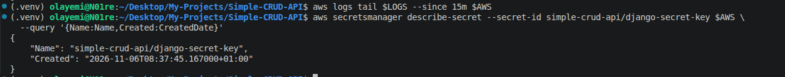

## Step 10: Stop the task and watch ECS recover

I stopped the running task on purpose:

```bash
TASK=$(aws ecs list-tasks --cluster $CLUSTER $AWS --query 'taskArns[0]' --output text)
aws ecs stop-task --cluster $CLUSTER --task $TASK --reason "resilience test" $AWS
```

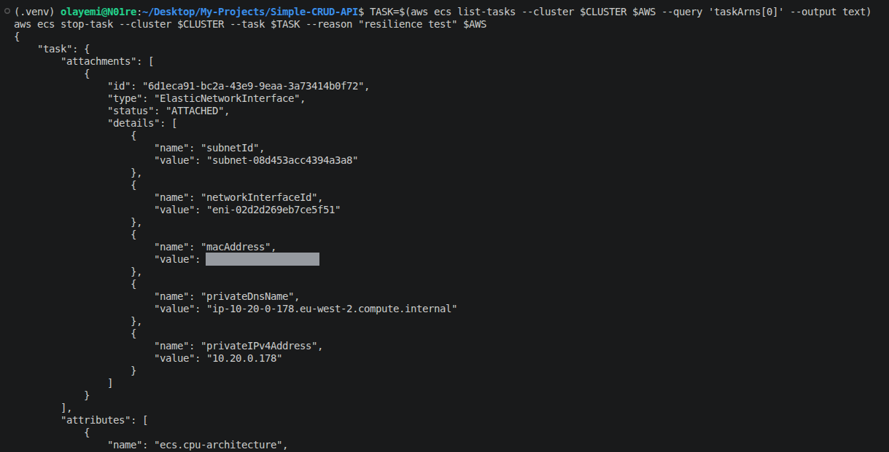

The service events show the old task draining and deregistering, a new task starting and registering, and the service reaching a steady state again. The overview briefly showed 0 running and 1 pending.

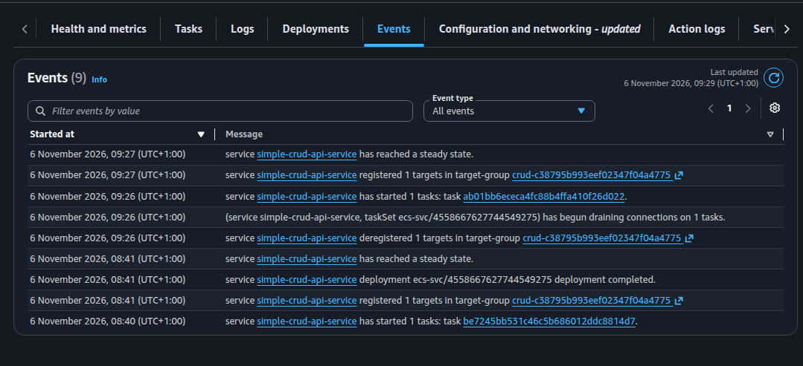

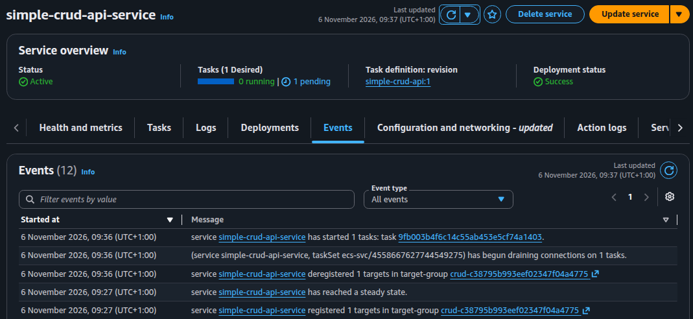

Because the database is SQLite inside the container, the replacement task starts with an empty database (see [Known limits](#known-limits)).

## Step 11: Roll out a new version

Build and push a new tag. Tags are immutable on purpose, so every release gets a new one.

```bash
docker build --platform linux/amd64 --provenance=false -t "$REPO:v2" .
docker push "$REPO:v2"
```

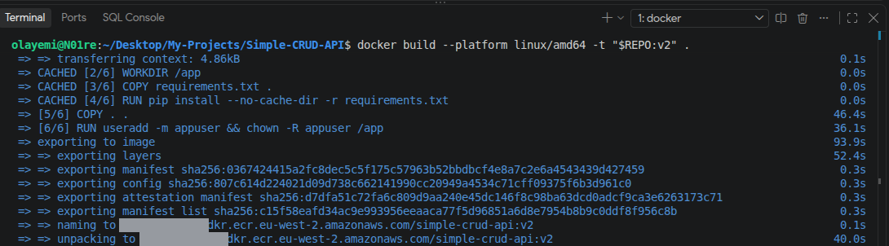

Set `image_tag = "v2"` in `terraform.tfvars` and run `terraform apply`. Terraform registers task definition revision 2 and ECS starts a rolling deployment.

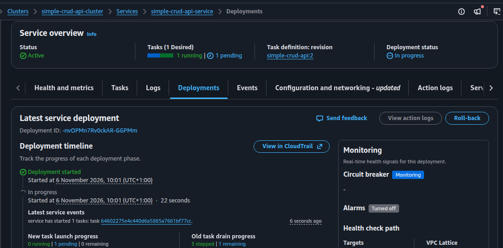

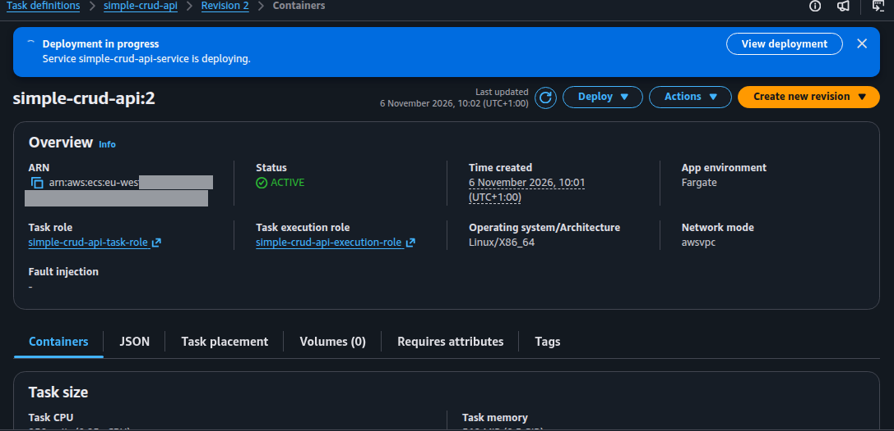

The new task started while the old one was still serving, the old task was drained and stopped, and the deployment completed with the circuit breaker at 0 of 3 failed tasks.

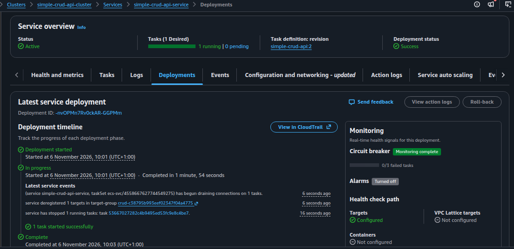

## Step 12: Destroy everything

The load balancer and the Fargate task bill by the hour, so I removed everything when I had my evidence:

```bash
terraform destroy
```

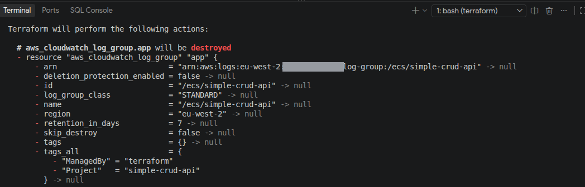

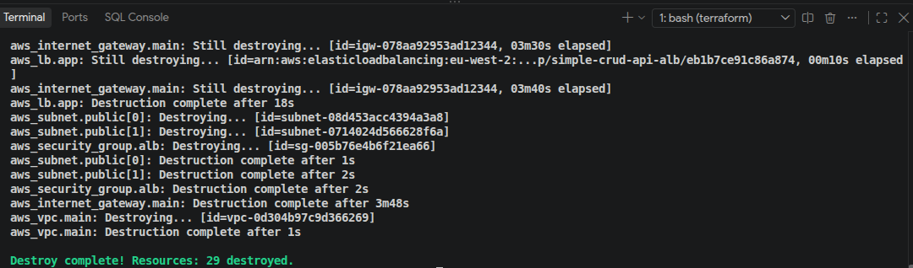

`Destroy complete! Resources: 29 destroyed.` The ECR repository is created with `force_delete = true` and the secret with `recovery_window_in_days = 0`, so both are removed immediately along with their contents. The Terraform state bucket is separate and stays.

## Results summary

| What I tested | Result |
|---|---|
| `terraform validate` | Configuration valid |
| Image pushed to ECR (`v1`) | Scan on push: 0 critical, 4 high, 9 medium, 3 low findings (ECR basic scanning, base image not patched) |
| ECS service | `ACTIVE`, 1 running of 1 desired, deployment status Success |
| Target group | 1 target, `healthy` on port 8000 |
| Secret key | Read from Secrets Manager (`valueFrom`), no value in the code or the task definition |
| API through the load balancer | Create, list, filter, `PATCH` and delete (204) work, including pagination (26 items, `next` link) and the duplicate-name validation error |
| Direct request to the task's public IP on port 8000 | Timed out, so the load balancer is the only way in |
| Stopped the running task | ECS started a replacement and the service returned to 1/1 running |
| Rolled out image tag `v2` | Task definition revision 2, old and new tasks ran side by side, old task drained, circuit breaker 0/3 failed tasks |
| `terraform destroy` | 29 resources destroyed, including the ECR repository and its images |

## Problems I hit and how I fixed them

| Problem | Cause and fix |
|---|---|
| Container crashed with `ModuleNotFoundError: pkg_resources` | gunicorn 20.1.0 needs `pkg_resources`, which newer setuptools removed. Upgraded to `gunicorn==23.0.0`. |
| ECR showed "Scan not found" | Docker's buildx pushes an image index plus an attestation manifest, and ECR cannot scan an index. The scan result is on the child image, and building with `--provenance=false` pushes a single scannable image. |
| Re-pushing the same tag was rejected | The repository has immutable tags on purpose, so every release gets a new tag. |
| Health check would fail with `Invalid HTTP_HOST header` | The load balancer sends the task's private IP as the Host header, so `DJANGO_ALLOWED_HOSTS` is `*` in the task definition. Safe here because only my IP can reach the load balancer. |
| Docker login failed with a credential helper error | Used a clean `DOCKER_CONFIG` directory for the ECR login instead of the broken helper. |
| `docker push` timed out on a large layer | Pushes resume, so I ran the same command again. |
| `curl: Could not resolve host` after opening a new terminal | Shell variables like `$ALB` do not survive a new terminal. Re-read them from `terraform output`. |

## Known limits

- SQLite data is lost whenever the task is replaced (the list was empty after I stopped the task), and `desired_count` must stay at 1. Moving to RDS PostgreSQL is the proper fix.
- Traffic is HTTP only. HTTPS needs a domain and an ACM certificate.
- The secret key is stored in Terraform state, which is why the state bucket is encrypted.
- gunicorn does not write an access log by default. Add `--access-logfile -` to the Dockerfile command to see requests in CloudWatch.
- The tasks run in public subnets to avoid the cost of a NAT gateway. A production setup would use private subnets.
